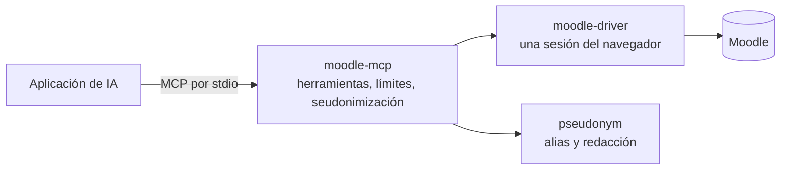

# Desarrollar moodle-mcp

moodle-mcp es una capa fina: un servidor MCP escrito en TypeScript, en el que cada herramienta es un esquema, una descripción y una llamada a [moodle-driver](https://falkenslab.github.io/moodle-driver/). Todo lo que lee o escribe en Moodle está en el driver, y la seudonimización está en [@falkenslab/pseudonym](https://www.npmjs.com/package/@falkenslab/pseudonym). Los dos vienen de npm y se empaquetan dentro del servidor.



Así que un cambio en cómo se lee o se escribe Moodle va primero al repositorio del driver (una versión allí, y después una subida de versión aquí).

## Compilar

Desde un clon de [falkenslab/moodle-mcp](https://github.com/falkenslab/moodle-mcp), con Node.js 20 o posterior:

```bash
npm install
npm run build       # bundles src/ into dist/server.mjs
npm run dev         # rebuilds on every change
npm run typecheck
npm run lint
```

Para usar tu compilación en una aplicación de IA, dale `node` con la ruta a `dist/server.mjs` en lugar de `npx -y @falkenslab/moodle-mcp`:

```bash
claude mcp add moodle-dev -e MOODLE_URL=http://localhost:8080 -- node /path/to/moodle-mcp/dist/server.mjs
```

## Probar el servidor a mano

El [MCP Inspector](https://github.com/modelcontextprotocol/inspector) abre una página web para listar y llamar a las herramientas:

```bash
npm run inspect
```

O desde la línea de comandos. Esto lista las herramientas comprobando que sus esquemas funcionan en todos los clientes (no debe mostrar ningún aviso), y llama a una:

```bash
npx @modelcontextprotocol/inspector --cli node dist/server.mjs -e MOODLE_URL=http://localhost:8080 --method tools/list --strict
npx @modelcontextprotocol/inspector --cli node dist/server.mjs -e MOODLE_URL=http://localhost:8080 --method tools/call --tool-name server_info
```

## Dónde está cada cosa

| Ruta | Qué hay |
| --- | --- |
| `src/server.ts`, `src/createServer.ts` | El arranque, y el servidor con sus herramientas y límites |
| `src/config.ts` | Los ajustes del entorno y de los argumentos |
| `src/instructions.ts` | Lo que el servidor le dice al agente sobre cómo trabajar en Moodle |
| `src/tools/` | Un archivo por herramienta o pequeña familia, registrados en `index.ts` |
| `src/tools/scopes.ts`, `roles.ts` | Qué funciones del driver llama cada herramienta, y a qué rol pertenece |
| `src/people.ts` | Alias y redacción para las herramientas que muestran personas o actúan sobre ellas |
| `test/` | Pruebas contra el Moodle simulado del driver |
| `docs/` | Este sitio |
| `.minispec/` | La especificación del proyecto y sus decisiones de diseño |

## Añadir una herramienta

1. La parte de Moodle es una función de moodle-driver, publicada primero allí.
2. Un archivo en `src/tools/`, registrado en `src/tools/index.ts`, con sus funciones del driver en `TOOL_FUNCTIONS` (`src/tools/scopes.ts`) y la herramienta en una lista de rol (`src/tools/roles.ts`). Si no, fallan las pruebas.
3. Una herramienta que muestra a otras personas o actúa sobre ellas pasa por `src/people.ts`: alias con `pseudonymize`, texto redactado, y alias rechazados en el texto que se escribe en Moodle.
4. Una prueba contra el Moodle simulado, la comprobación `--strict` y una prueba contra un Moodle real ([Pruebas](./testing.md)), ya que las salidas del driver deben coincidir exactamente con el esquema de salida de la herramienta.

La [referencia de herramientas](../reference/tools.md) se genera a partir del servidor, así que se actualiza sola. Las skills de Claude Code de `.claude/skills/` (`add-tool`, `verify`, `update-docs`…) contienen las listas de comprobación completas.

## Este sitio

El sitio es [Docusaurus](https://docusaurus.io), en `docs/`, en inglés (`docs/content/`) y en español (`docs/i18n/es/`):

```bash
cd docs
npm install
npm run tools       # regenerates the tools reference from ../dist/server.mjs
npm start           # English, with live reload
npm run start:es    # Spanish
npm run build       # both, into docs/build
```

Se publica en GitHub Pages desde `main` con `.github/workflows/docs.yml`. Cada versión conserva una copia de su documentación, que aparece en el menú de versiones.
