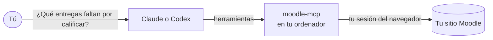

# ¿Qué es moodle-mcp?

moodle-mcp permite que un agente de IA como **Claude** o **Codex** trabaje en tus cursos de Moodle **como tú**. Tú lo pides con tus palabras y el agente hace los clics: encuentra lo que falta por calificar, lee las entregas, monta un cuestionario con tus preguntas, responde en un foro o le dice a un alumno qué tiene que entregar esta semana.

<Screenshot app="Claude Code" session="grading" alt="Claude Code calificando una entrega en Moodle con moodle-mcp" />

## Cómo funciona

moodle-mcp es un [servidor MCP](https://modelcontextprotocol.io). Es un pequeño programa que tu aplicación de IA arranca en segundo plano y que le da al agente unas 230 herramientas para Moodle. Cuando el agente usa una, moodle-mcp hace el trabajo en un navegador real de tu ordenador, con tu sesión iniciada.

Así que hace lo que puede hacer tu cuenta, en cualquier sitio Moodle:

- **Nada que configurar en Moodle.** No necesita tokens de servicios web, ni un administrador, ni un plugin. Si puedes iniciar sesión, funciona.
- **Inicias sesión tú mismo**, en una ventana del navegador que se abre la primera vez, con inicio de sesión único y verificación en dos pasos si tu sitio los usa. Nunca ve ni guarda tu contraseña.
- **Tus alumnos son anónimos para la IA.** Por defecto, el agente ve a las demás personas como alias del tipo `A-7KQ2XM`, nunca sus nombres. Solo tú puedes convertir un alias en un nombre, en tu ordenador. Consulta [Privacidad del alumnado](./privacy.md).
- **Tú decides qué puede hacer.** Puedes permitir solo leer, solo crear contenido del curso o solo las herramientas que necesita un alumno. Consulta [Limitar lo que puede hacer el agente](./limits.md).
- **Pregunta antes de cambiar nada.** Cada herramienta que cambia Moodle (una nota, un mensaje en un foro, una actividad nueva) está marcada como tal, y el agente tiene instrucciones de consultarte antes.

## Qué puedes pedirle

Como **docente**:

- "¿Qué tareas de Programación 1 tienen todavía entregas por calificar?"
- "Lee las entregas de la Tarea 3 y propón una nota con la rúbrica. No guardes nada todavía."
- "Importa estas preguntas GIFT y crea con ellas un cuestionario en la sección 2."
- "¿Qué preguntas del foro no ha respondido nadie?"
- "¿Quién no ha abierto los apuntes del tema 4? Mándales un recordatorio amable."
- "Crea una página oculta con este resumen y este diagrama."

Como **alumno**:

- "¿Qué tengo que entregar esta semana en todos mis cursos?"
- "Hazme una hoja de estudio con las páginas del tema 3."
- "¿Qué he fallado en mi último cuestionario?"
- "Haz la actividad SCORM del tema 2 y dime la nota."

Los [casos de uso](./use-cases/index.md) muestran cada uno de estos ejemplos con sesiones reales, paso a paso.

## Qué necesitas

- Un ordenador con **Windows, macOS o Linux**, y **Node.js 20** o posterior.
- **Microsoft Edge** o **Google Chrome** (o nada: descarga su propio navegador la primera vez).
- Una aplicación de IA compatible con MCP: **[Claude Code](./getting-started/claude-code.md)**, **[Claude Desktop](./getting-started/claude-desktop.md)**, **[Codex](./getting-started/codex.md)** u otra.
- Tu usuario de Moodle de siempre, en un sitio Moodle 4.5 o 5.x.

¿Listo? Empieza por los [requisitos](./getting-started/requirements.md).

:::note Primeros pasos
moodle-mcp es joven (versión 0.x). Está probado con Moodle 4.5 y 5.x, con los temas Boost y Classic, y las herramientas aún pueden cambiar entre versiones. Si algo no funciona en tu sitio, [abre una incidencia](https://github.com/falkenslab/moodle-mcp/issues).
:::
