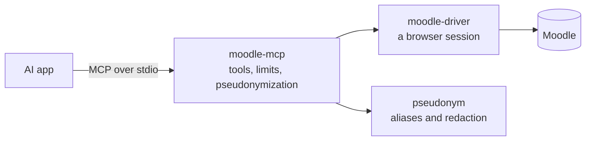

# Developing moodle-mcp

moodle-mcp is a thin layer: an MCP server written in TypeScript, where each tool is a schema, a description and a call to [moodle-driver](https://falkenslab.github.io/moodle-driver/). Everything that reads or writes Moodle is in the driver, and pseudonymization is in [@falkenslab/pseudonym](https://www.npmjs.com/package/@falkenslab/pseudonym). Both come from npm and are bundled into the server.



So a change to how Moodle is read or written goes to the driver's repository first (a release there, then a version bump here).

## Building

From a clone of [falkenslab/moodle-mcp](https://github.com/falkenslab/moodle-mcp), with Node.js 20 or later:

```bash
npm install
npm run build       # bundles src/ into dist/server.mjs
npm run dev         # rebuilds on every change
npm run typecheck
npm run lint
```

To use your build in an AI app, give it `node` with the path to `dist/server.mjs` instead of `npx -y @falkenslab/moodle-mcp`:

```bash
claude mcp add moodle-dev -e MOODLE_URL=http://localhost:8080 -- node /path/to/moodle-mcp/dist/server.mjs
```

## Trying the server by hand

The [MCP Inspector](https://github.com/modelcontextprotocol/inspector) opens a web page to list and call the tools:

```bash
npm run inspect
```

Or from the command line. This lists the tools with a check that their schemas work in every client (it must report no warnings), and calls one:

```bash
npx @modelcontextprotocol/inspector --cli node dist/server.mjs -e MOODLE_URL=http://localhost:8080 --method tools/list --strict
npx @modelcontextprotocol/inspector --cli node dist/server.mjs -e MOODLE_URL=http://localhost:8080 --method tools/call --tool-name server_info
```

## Where things are

| Path | What's there |
| --- | --- |
| `src/server.ts`, `src/createServer.ts` | Start-up, and the server with its tools and limits |
| `src/config.ts` | Settings from the environment and arguments |
| `src/instructions.ts` | What the server tells the agent about working in Moodle |
| `src/tools/` | One file per tool or small family, registered in `index.ts` |
| `src/tools/scopes.ts`, `roles.ts` | Which driver functions each tool calls, and which role it belongs to |
| `src/people.ts` | Aliases and redaction for tools that show or act on people |
| `test/` | Tests against the driver's fake Moodle |
| `docs/` | This site |
| `.minispec/` | The project's specification and design decisions |

## Adding a tool

1. The Moodle side is a moodle-driver function, released there first.
2. One file in `src/tools/`, registered in `src/tools/index.ts`, with its driver functions in `TOOL_FUNCTIONS` (`src/tools/scopes.ts`) and the tool in one role list (`src/tools/roles.ts`). Tests fail otherwise.
3. A tool that shows or acts on other people goes through `src/people.ts`: aliases under `pseudonymize`, redacted text, and aliases refused in text written to Moodle.
4. A test against the fake Moodle, the `--strict` check, and a check against a real Moodle ([Testing](./testing.md)), since the driver's outputs must match the tool's output schema exactly.

The [tools reference](../reference/tools.md) is generated from the server, so it updates itself. The Claude Code skills in `.claude/skills/` (`add-tool`, `verify`, `update-docs`…) hold the full checklists.

## This site

The site is [Docusaurus](https://docusaurus.io), in `docs/`, in English (`docs/content/`) and Spanish (`docs/i18n/es/`):

```bash
cd docs
npm install
npm run tools       # regenerates the tools reference from ../dist/server.mjs
npm start           # English, with live reload
npm run start:es    # Spanish
npm run build       # both, into docs/build
```

It's published to GitHub Pages from `main` by `.github/workflows/docs.yml`. Each release keeps a copy of its docs, listed in the version menu.
