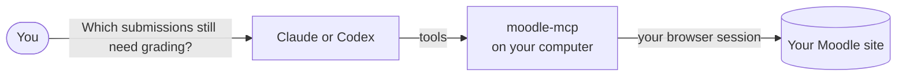

# What is moodle-mcp?

moodle-mcp lets an AI agent such as **Claude** or **Codex** work in your Moodle courses **as you**. You ask in your own words, and the agent does the clicking: it finds what needs grading, reads the submissions, builds a quiz from your questions, answers a forum, or tells a student what's due this week.

<Screenshot app="Claude Code" session="grading" alt="Claude Code grading a submission in Moodle with moodle-mcp" />

## How it works

moodle-mcp is an [MCP server](https://modelcontextprotocol.io). It's a small program that your AI app starts in the background, and it gives the agent about 230 tools for Moodle. When the agent uses one, moodle-mcp does the work in a real browser on your computer, logged in as you.

So it does what your account can do, on any Moodle site:

- **No setup in Moodle.** It doesn't need web service tokens, an administrator or a plugin. If you can log in, it works.
- **You log in yourself**, in a browser window it opens the first time, with single sign-on and two-factor authentication if your site uses them. It never sees or stores your password.
- **Your students stay anonymous to the AI.** By default the agent sees other people as aliases such as `A-7KQ2XM`, never their names. Only you can turn an alias back into a name, on your computer. See [Students' privacy](./privacy.md).
- **You decide what it may do.** You can allow only reading, only building course content, or only the tools a student needs. See [Limiting what the agent can do](./limits.md).
- **It asks before changing things.** Every tool that changes Moodle (a grade, a post, a new activity) is marked as such, and the agent is told to check with you first.

## What you can ask

As a **teacher**:

- "Which assignments in Programming 1 still have submissions to grade?"
- "Read the submissions to Task 3 and suggest a grade with the rubric. Don't save anything yet."
- "Import these GIFT questions and make a quiz with them in section 2."
- "Which forum questions has nobody answered?"
- "Who hasn't opened the notes for unit 4? Send them a friendly reminder."
- "Create a hidden page with this summary and this diagram."

As a **student**:

- "What's due this week across my courses?"
- "Make me a study sheet from the unit 3 pages."
- "What did I get wrong in my last quiz?"
- "Do the SCORM activity of unit 2 and tell me the grade."

The [use cases](./use-cases/index.md) show each of these with real sessions, step by step.

## What you need

- A computer with **Windows, macOS or Linux**, and **Node.js 20** or later.
- **Microsoft Edge** or **Google Chrome** (or nothing: it downloads its own browser the first time).
- An AI app that supports MCP: **[Claude Code](./getting-started/claude-code.md)**, **[Claude Desktop](./getting-started/claude-desktop.md)**, **[Codex](./getting-started/codex.md)** or another.
- Your usual Moodle login, on a Moodle 4.5 or 5.x site.

Ready? Start with the [requirements](./getting-started/requirements.md).

:::note Early days
moodle-mcp is young (version 0.x). It's tested against Moodle 4.5 and 5.x, with the Boost and Classic themes, and the tools may still change between versions. If something doesn't work on your site, please [open an issue](https://github.com/falkenslab/moodle-mcp/issues).
:::
